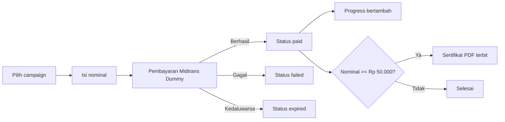

<div align="center">

# Impactly

### Platform Donasi Online Berbasis Web

Donasi dengan nominal bebas, pantau penyaluran dananya, dan dapatkan sertifikat digital sebagai apresiasi.


**Proyek UTS E-Application · D3 Teknik Informatika**

</div>

---

## 📖 Tentang Impactly

Banyak orang ragu berdonasi online karena tidak tahu apakah dananya benar-benar sampai ke penerima manfaat. Impactly menjawabnya dengan tiga hal: **setiap campaign diverifikasi admin** sebelum tayang, **setiap campaign punya berita dan laporan penyaluran dana**, dan **setiap donasi tercatat** dengan status yang jelas.

## ✨ Fitur Utama

| | Fitur | Keterangan |
| --- | --- | --- |
| 🔐 | Login multi-role | Donatur, penggalang dana, dan admin punya hak akses berbeda |
| 📝 | CRUD campaign | Penggalang membuat, mengubah, dan menghapus campaign |
| ✅ | Verifikasi admin | Campaign tayang publik setelah disetujui admin |
| 💸 | Donasi nominal bebas | Berapa pun nominalnya, dengan opsi donasi anonim |
| 💳 | Midtrans Dummy | Pembayaran simulasi dengan status pending, paid, failed, expired |
| 📊 | Progress bar otomatis | Dihitung dari donasi yang berhasil dibayar |
| 📰 | Berita dan penyaluran dana | Kabar terbaru dan laporan penggunaan dana di tiap campaign |
| 🏅 | Sertifikat digital (PDF) | Terbit otomatis untuk donasi mulai Rp 50.000 |
| 🏆 | Top donatur | Papan peringkat donatur dengan opsi anonim |

## 👥 Peran Pengguna

| Peran | Yang bisa dilakukan |
| --- | --- |
| **Tamu** | Melihat beranda, campaign, dan top donatur tanpa login |
| **Donatur** | Berdonasi, melihat riwayat, dan mengunduh sertifikat |
| **Penggalang dana** | Membuat campaign, memposting berita, dan melaporkan penyaluran dana |
| **Administrator** | Memverifikasi campaign, mengelola pengguna, dan memoderasi konten |

## 🔄 Alur Donasi



## 🛠️ Teknologi

- **Backend:** PHP 8.2+, Laravel 12
- **Frontend:** Blade, Bootstrap 5.3, Bootstrap Icons
- **Database:** MySQL
- **Pembayaran:** Midtrans Dummy (Snap SDK)
- **PDF:** barryvdh/laravel-dompdf

## 🚀 Cara Menjalankan

### Yang harus ada dulu

| Aplikasi | Fungsi | Unduh |
| --- | --- | --- |
| **XAMPP** (PHP 8.2 atau lebih baru) | Menyediakan PHP dan database MySQL | apachefriends.org |
| **Composer** | Memasang pustaka yang dibutuhkan Laravel | getcomposer.org |
| **Git** | Mengunduh proyek dari GitHub | git-scm.com |

> Tidak mau memasang Git? Di halaman repo ini klik tombol hijau **Code > Download ZIP**, ekstrak, lalu buka terminal di dalam folder hasil ekstrak dan lewati langkah 1.

### Langkah-langkah

Cara menjalankannya terdiri dari tiga bagian: **terminal**, **phpMyAdmin**, lalu **terminal** lagi. Terminal yang dimaksud adalah **Command Prompt** atau terminal VS Code. Tekan Enter setelah setiap perintah dan tunggu sampai selesai.

#### Bagian 1. Siapkan proyek (di terminal)

**Langkah 1. Unduh proyek**
```bash
git clone https://github.com/jelitazalukhu/Impactly-E-Donation.git
cd Impactly-E-Donation
```
Perintah pertama mengunduh proyek, yang kedua masuk ke foldernya.

**Langkah 2. Pasang pustaka Laravel**
```bash
composer install
```
Proyek ini tidak membawa folder `vendor` (berisi pustaka Laravel), jadi perintah ini mengunduhnya. Butuh internet dan beberapa menit. Berhasil kalau muncul folder `vendor` dan tidak ada tulisan merah.

**Langkah 3. Siapkan pengaturan**
```bash
copy .env.example .env
php artisan key:generate
php artisan storage:link
```
Perintah pertama membuat berkas pengaturan `.env`, yang kedua membuat kunci keamanan aplikasi, dan yang ketiga menghubungkan folder foto. Berhasil kalau muncul "Application key set successfully".
Di Mac atau Linux, ganti `copy` dengan `cp`.

> Biarkan terminal ini terbuka, nanti kita kembali ke sini di Bagian 3.

#### Bagian 2. Siapkan database (XAMPP dan phpMyAdmin)

**Langkah 4. Nyalakan MySQL**
Buka **XAMPP Control Panel**, lalu klik **Start** pada baris **MySQL**. Tulisannya akan berwarna hijau.

**Langkah 5. Buat database kosong**
Buka http://localhost/phpmyadmin di browser, klik **Baru** (New), isi nama database `e_donation`, lalu klik **Buat**.

**Langkah 6. Isi tabel dan data contoh**
Klik database `e_donation` di daftar kiri, buka tab **Impor**, pilih berkas `database/e_donation.sql` dari folder proyek, lalu klik **Kirim**. Berhasil kalau muncul tulisan hijau dan tabel-tabelnya tampil di daftar kiri.

#### Bagian 3. Jalankan aplikasi (kembali ke terminal)

**Langkah 7. Jalankan**
```bash
php artisan serve
```
Biarkan jendela ini tetap terbuka, lalu buka **http://127.0.0.1:8000** di browser. Untuk menghentikannya, tekan **Ctrl + C**.

### Kalau ada masalah

| Pesan atau kondisi | Penyebab dan solusi |
| --- | --- |
| `composer` tidak dikenali | Composer belum terpasang. Pasang lalu buka ulang terminal |
| `could not find driver` atau koneksi database gagal | MySQL belum dinyalakan di XAMPP (langkah 4) |
| `Unknown database 'e_donation'` | Database belum dibuat (langkah 5) |
| Campaign kosong atau tidak bisa login | Data belum diimpor (langkah 6) |
| `Table ... already exists` saat impor | Database sudah berisi tabel. Hapus database `e_donation`, buat ulang yang kosong, lalu impor lagi |
| Foto campaign tidak muncul | Jalankan `php artisan storage:link` (langkah 3) |
| `Your requirements could not be resolved` | PHP di XAMPP kurang dari 8.2. Pasang XAMPP versi terbaru |
| `zip extension` tidak ditemukan saat `composer install` | Buka `php.ini` di XAMPP, hapus tanda `;` di depan `extension=zip`, lalu ulangi |
| Port 8000 sedang dipakai | Jalankan `php artisan serve --port=8001`, lalu buka http://127.0.0.1:8001 |

## 🔑 Akun Demo

| Peran | Email | Password |
| --- | --- | --- |
| Admin | admin@edonation.test | Admin#12345 |
| Penggalang dana | yayasan@demo.test | password123 |
| Donatur | maya@demo.test | password123 |

## 🗄️ Struktur Database

Delapan tabel: `users`, `categories`, `campaigns`, `donations`, `payments`, `certificates`, `campaign_updates`, dan `fund_distributions`.

## 👩‍💻 Anggota Kelompok

| Nama | NIM |
| --- | --- |
| Jelita Crisna Zalukhu | 241712022 |
| Kabul Manik | 241712023 |

---

<div align="center">

Dibuat untuk memenuhi tugas UTS E-Application · D3 Teknik Informatika

</div>
